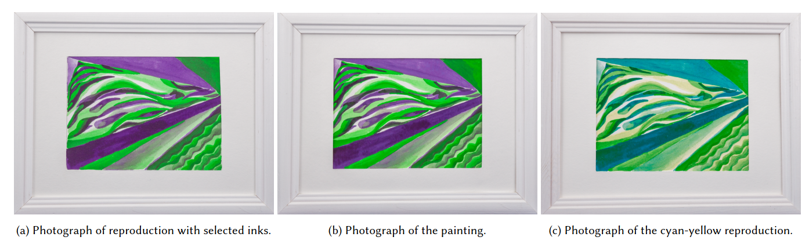

# Mixed integer ink selection
#### NAVID ANSARI, Max Planck Institute for Informatics, Germany
#### OMID ALIZADEH-MOUSAVI, Depsys SA, Switzerland
#### HANS-PETER SEIDEL, Max Planck Institute for Informatics, Germany
#### VAHID BABAEI, Max Planck Institute for Informatics, Germany

#### Code and dataset of the paper "Mixed Integer Ink Selection for Spectral Reproduction"

There are two main parts to this project:

**1. MILP optimization:** In the _ink selection_ folder you will find the MATLAB code for solving the optimization using Gurobi and Yalmip and all the necessary data. 

**2. Neural network based spectral separation:** In the _spectral separation_ folder, you will find the neural network models and the dataset for training them.

In _Dataset_ folder you can find all the dataset that we have used in this project (watercolor paints' reflectance, oil paints' reflectance etc.) 
